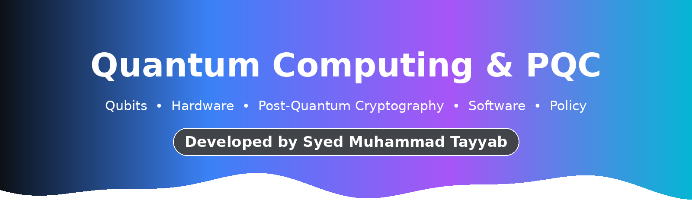
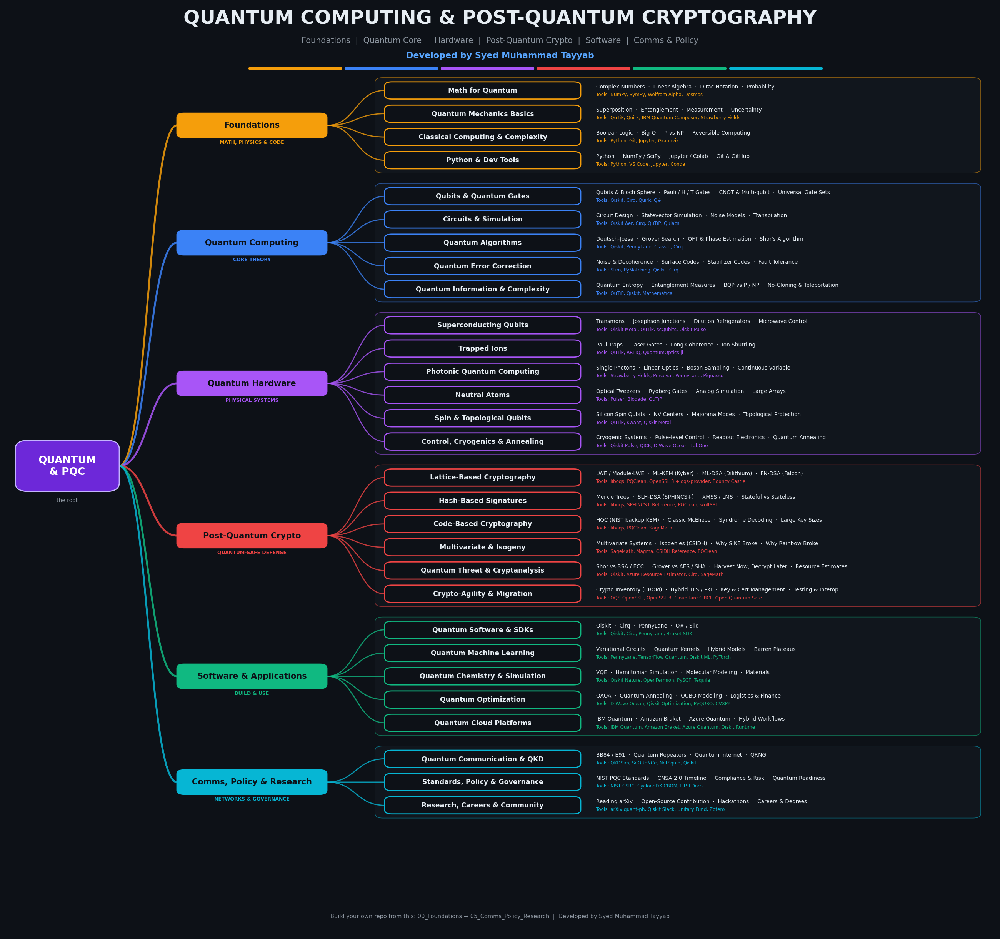
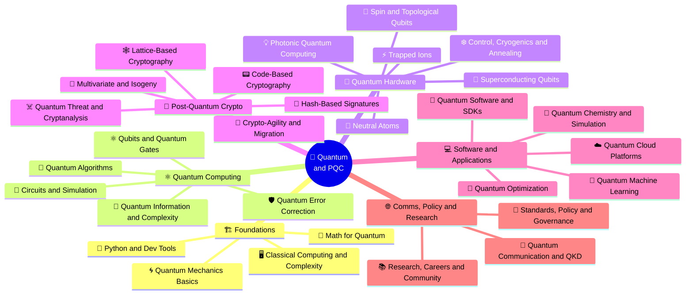
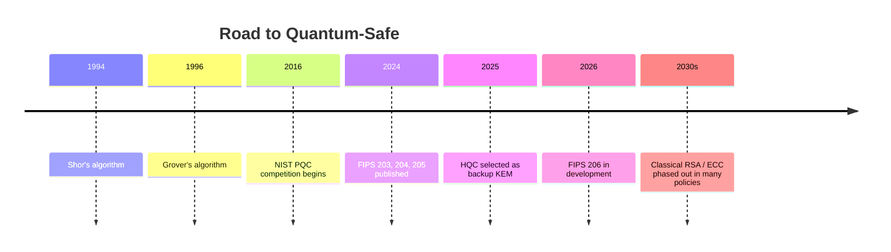
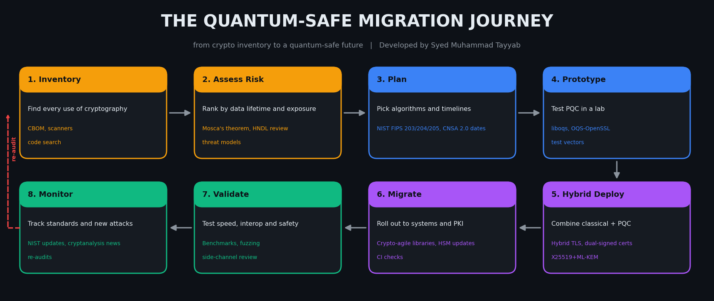
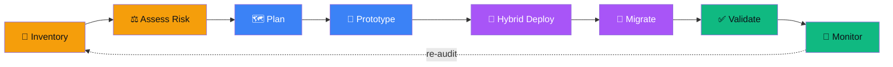
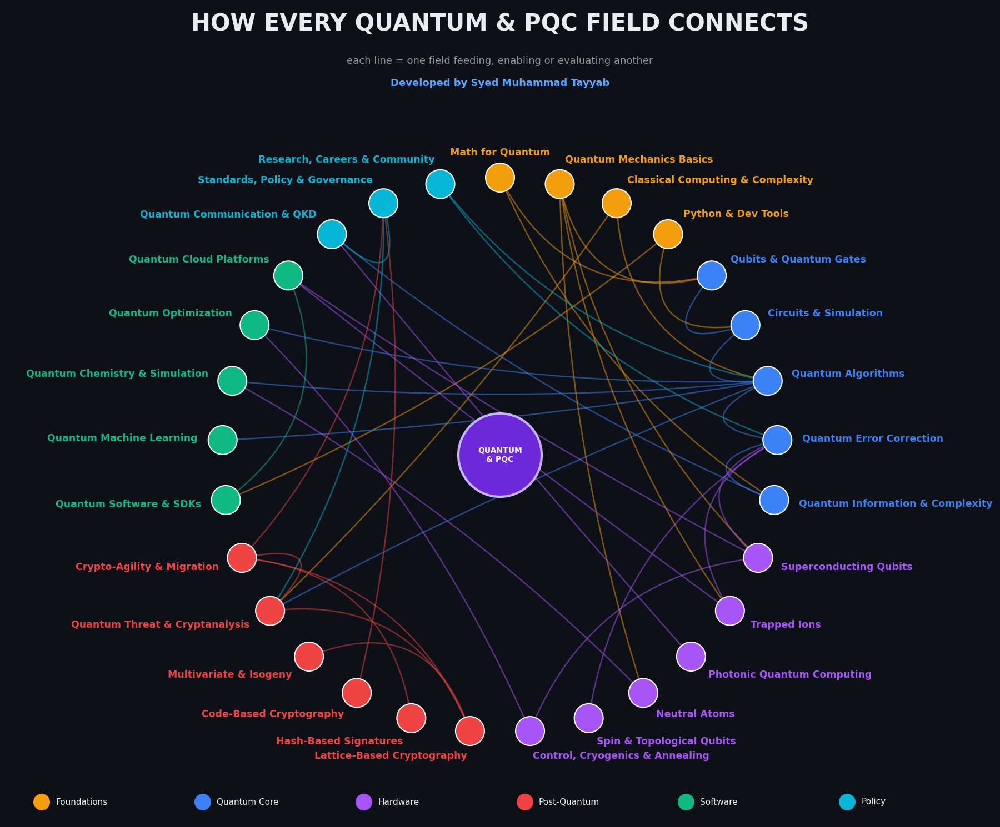
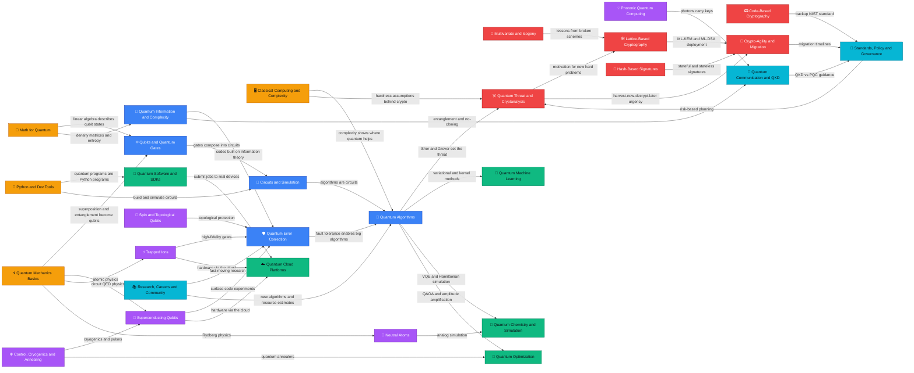
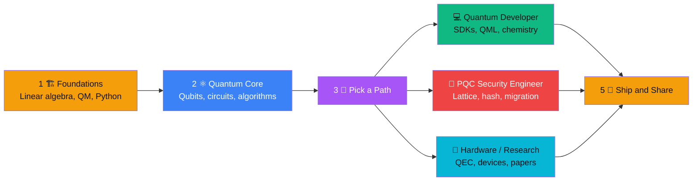
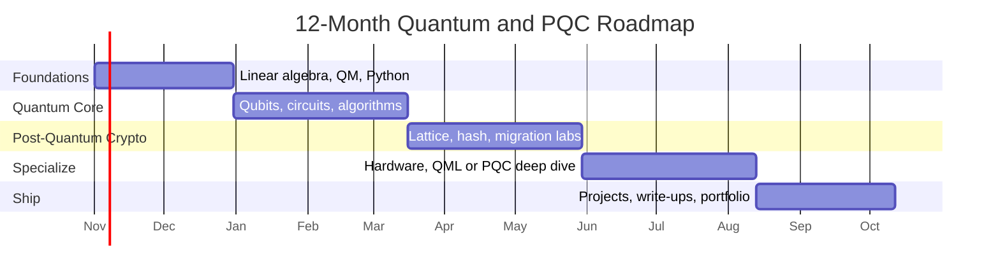

<div align="center">



<h3>✨ Developed by Syed Muhammad Tayyab ✨</h3>

<a href="https://github.com/Syed-Muhammad-Tayyab">
  
</a>

<br/>


<br/><br/>


<br/><br/>

<a href="#-the-big-picture"><b>🌴 Tree</b></a> &nbsp;•&nbsp; <a href="#-foundations--math-physics--code"><b>🏗️ Foundations</b></a> &nbsp;•&nbsp; <a href="#-quantum-computing--core-theory"><b>⚛️ Quantum</b></a> &nbsp;•&nbsp; <a href="#-quantum-hardware--physical-systems"><b>🧊 Hardware</b></a> &nbsp;•&nbsp; <a href="#-post-quantum-crypto--quantum-safe-defense"><b>🔐 PQC</b></a> &nbsp;•&nbsp; <a href="#-software--applications--build--use"><b>💻 Software</b></a> &nbsp;•&nbsp; <a href="#-comms-policy--research--networks--governance"><b>🌐 Policy</b></a> &nbsp;•&nbsp; <a href="#-how-everything-is-linked"><b>🔗 Links</b></a> &nbsp;•&nbsp; <a href="#-folder-structure"><b>📂 Folders</b></a> &nbsp;•&nbsp; <a href="#-learning--certification-roadmap"><b>🎓 Roadmap</b></a>

</div>

---

## 🌴 The Big Picture

<div align="center">
  
</div>

<div align="center">

| 🖼️ Picture | 📄 PDF Guide | 📊 Slides | 🔗 Link Map | 🔄 Migration Journey |
|:---:|:---:|:---:|:---:|:---:|
| [`qpqc_tree.png`](assets/qpqc_tree.png) | [`QPQC_Tree.pdf`](docs/QPQC_Tree.pdf) | [`QPQC_Tree.pptx`](docs/QPQC_Tree.pptx) | [`qpqc_link_map.png`](assets/qpqc_link_map.png) | [`qpqc_lifecycle.png`](assets/qpqc_lifecycle.png) |

</div>

### ⚖️ Two sides of one story

| | ⚛️ **Quantum Computing** | 🔐 **Post-Quantum Cryptography** |
|:---|:---|:---|
| **Idea** | Use quantum physics to compute in new ways | Use classical math that quantum computers can't break |
| **Runs on** | Qubits (special hardware or simulators) | Ordinary computers, phones and servers |
| **Key algorithms** | Shor, Grover, VQE, QAOA | ML-KEM, ML-DSA, SLH-DSA, FN-DSA, HQC |
| **Main goal** | Solve problems classical machines find too hard | Keep today's secrets safe from tomorrow's machines |
| **Status** | Research and early hardware | Standards published, migration underway |

### 🎯 What quantum computers threaten (and what they don't)

| Today's algorithm | Used for | Quantum impact | What to do |
|:---|:---|:---|:---|
| **RSA, DH** | Key exchange, signatures | ❌ Broken by Shor's algorithm | Move to ML-KEM / ML-DSA |
| **ECC (ECDH, ECDSA)** | Key exchange, signatures, TLS | ❌ Broken by Shor's algorithm | Move to ML-KEM / ML-DSA |
| **AES** | Bulk encryption | ⚠️ Grover roughly halves the effective key strength | Prefer AES-256 |
| **SHA-2 / SHA-3** | Hashing | ⚠️ Grover weakens preimage resistance | Use longer outputs (e.g. SHA-384 / 512) |
| **Hash-based signatures** | Firmware signing | ✅ Quantum-resistant by design | SLH-DSA, LMS / XMSS |

> [!WARNING]
> **Harvest now, decrypt later:** attackers can record encrypted traffic today and decrypt it once a large quantum computer exists. Data that must stay secret for many years needs quantum-safe protection **now**.

### 🌳 Tree view

```text
🌴 QUANTUM COMPUTING & POST-QUANTUM CRYPTOGRAPHY
├── 🏗️ FOUNDATIONS  (Math, Physics & Code)
│   ├── 🧮 Math for Quantum
│   │   ├── Complex Numbers
│   │   ├── Linear Algebra
│   │   ├── Dirac Notation
│   │   └── Probability
│   ├── 🌀 Quantum Mechanics Basics
│   │   ├── Superposition
│   │   ├── Entanglement
│   │   ├── Measurement
│   │   └── Uncertainty
│   ├── 🖥️ Classical Computing & Complexity
│   │   ├── Boolean Logic
│   │   ├── Big-O
│   │   ├── P vs NP
│   │   └── Reversible Computing
│   └── 🐍 Python & Dev Tools
│       ├── Python
│       ├── NumPy / SciPy
│       ├── Jupyter / Colab
│       └── Git & GitHub
├── ⚛️ QUANTUM COMPUTING  (Core Theory)
│   ├── ⚛️ Qubits & Quantum Gates
│   │   ├── Qubits & Bloch Sphere
│   │   ├── Pauli / H / T Gates
│   │   ├── CNOT & Multi-qubit
│   │   └── Universal Gate Sets
│   ├── 🔌 Circuits & Simulation
│   │   ├── Circuit Design
│   │   ├── Statevector Simulation
│   │   ├── Noise Models
│   │   └── Transpilation
│   ├── 🧠 Quantum Algorithms
│   │   ├── Deutsch-Jozsa
│   │   ├── Grover Search
│   │   ├── QFT & Phase Estimation
│   │   └── Shor's Algorithm
│   ├── 🛡️ Quantum Error Correction
│   │   ├── Noise & Decoherence
│   │   ├── Surface Codes
│   │   ├── Stabilizer Codes
│   │   └── Fault Tolerance
│   └── 📡 Quantum Information & Complexity
│       ├── Quantum Entropy
│       ├── Entanglement Measures
│       ├── BQP vs P / NP
│       └── No-Cloning & Teleportation
├── 🧊 QUANTUM HARDWARE  (Physical Systems)
│   ├── 🧊 Superconducting Qubits
│   │   ├── Transmons
│   │   ├── Josephson Junctions
│   │   ├── Dilution Refrigerators
│   │   └── Microwave Control
│   ├── ⚡ Trapped Ions
│   │   ├── Paul Traps
│   │   ├── Laser Gates
│   │   ├── Long Coherence
│   │   └── Ion Shuttling
│   ├── 💡 Photonic Quantum Computing
│   │   ├── Single Photons
│   │   ├── Linear Optics
│   │   ├── Boson Sampling
│   │   └── Continuous-Variable
│   ├── 🔬 Neutral Atoms
│   │   ├── Optical Tweezers
│   │   ├── Rydberg Gates
│   │   ├── Analog Simulation
│   │   └── Large Arrays
│   ├── 🧲 Spin & Topological Qubits
│   │   ├── Silicon Spin Qubits
│   │   ├── NV Centers
│   │   ├── Majorana Modes
│   │   └── Topological Protection
│   └── ❄️ Control, Cryogenics & Annealing
│       ├── Cryogenic Systems
│       ├── Pulse-level Control
│       ├── Readout Electronics
│       └── Quantum Annealing
├── 🔐 POST-QUANTUM CRYPTO  (Quantum-Safe Defense)
│   ├── 🕸️ Lattice-Based Cryptography
│   │   ├── LWE / Module-LWE
│   │   ├── ML-KEM (Kyber)
│   │   ├── ML-DSA (Dilithium)
│   │   └── FN-DSA (Falcon)
│   ├── 🌳 Hash-Based Signatures
│   │   ├── Merkle Trees
│   │   ├── SLH-DSA (SPHINCS+)
│   │   ├── XMSS / LMS
│   │   └── Stateful vs Stateless
│   ├── 📟 Code-Based Cryptography
│   │   ├── HQC (NIST backup KEM)
│   │   ├── Classic McEliece
│   │   ├── Syndrome Decoding
│   │   └── Large Key Sizes
│   ├── 🧬 Multivariate & Isogeny
│   │   ├── Multivariate Systems
│   │   ├── Isogenies (CSIDH)
│   │   ├── Why SIKE Broke
│   │   └── Why Rainbow Broke
│   ├── ☠️ Quantum Threat & Cryptanalysis
│   │   ├── Shor vs RSA / ECC
│   │   ├── Grover vs AES / SHA
│   │   ├── Harvest Now, Decrypt Later
│   │   └── Resource Estimates
│   └── 🔄 Crypto-Agility & Migration
│       ├── Crypto Inventory (CBOM)
│       ├── Hybrid TLS / PKI
│       ├── Key & Cert Management
│       └── Testing & Interop
├── 💻 SOFTWARE & APPLICATIONS  (Build & Use)
│   ├── 🧰 Quantum Software & SDKs
│   │   ├── Qiskit
│   │   ├── Cirq
│   │   ├── PennyLane
│   │   └── Q# / Silq
│   ├── 🤖 Quantum Machine Learning
│   │   ├── Variational Circuits
│   │   ├── Quantum Kernels
│   │   ├── Hybrid Models
│   │   └── Barren Plateaus
│   ├── 🧪 Quantum Chemistry & Simulation
│   │   ├── VQE
│   │   ├── Hamiltonian Simulation
│   │   ├── Molecular Modeling
│   │   └── Materials
│   ├── 🎯 Quantum Optimization
│   │   ├── QAOA
│   │   ├── Quantum Annealing
│   │   ├── QUBO Modeling
│   │   └── Logistics & Finance
│   └── ☁️ Quantum Cloud Platforms
│       ├── IBM Quantum
│       ├── Amazon Braket
│       ├── Azure Quantum
│       └── Hybrid Workflows
└── 🌐 COMMS, POLICY & RESEARCH  (Networks & Governance)
    ├── 🔑 Quantum Communication & QKD
    │   ├── BB84 / E91
    │   ├── Quantum Repeaters
    │   ├── Quantum Internet
    │   └── QRNG
    ├── 📜 Standards, Policy & Governance
    │   ├── NIST PQC Standards
    │   ├── CNSA 2.0 Timeline
    │   ├── Compliance & Risk
    │   └── Quantum Readiness
    └── 📚 Research, Careers & Community
        ├── Reading arXiv
        ├── Open-Source Contribution
        ├── Hackathons
        └── Careers & Degrees
```

### 🧭 Mind map



---

## 📜 PQC Standards at a Glance

> [!NOTE]
> Status below follows NIST's PQC project page (updated August 2026). Standards and timelines keep changing, so always confirm on [csrc.nist.gov](https://csrc.nist.gov/projects/post-quantum-cryptography) before relying on them.

| Standard | Algorithm (original name) | Type | Status |
|:---|:---|:---|:---|
| **FIPS 203** | ML-KEM (CRYSTALS-Kyber) | Key encapsulation | ✅ Published Aug 13, 2024 |
| **FIPS 204** | ML-DSA (CRYSTALS-Dilithium) | Digital signature | ✅ Published Aug 13, 2024 |
| **FIPS 205** | SLH-DSA (SPHINCS+) | Hash-based signature | ✅ Published Aug 13, 2024 |
| **FIPS 206** | FN-DSA (FALCON) | Digital signature | 🛠️ In development |
| **HQC** | HQC (Hamming Quasi-Cyclic) | Backup KEM (code-based) | 🧭 Selected March 11, 2025 for standardization |

### 📏 Why size matters (approximate, bytes)

| Scheme | Public key | Ciphertext / signature | Note |
|:---|:---:|:---:|:---|
| X25519 (classical) | 32 | 32 | tiny, but not quantum-safe |
| ML-KEM-768 | ~1,184 | ~1,088 | the common default KEM |
| ML-DSA-65 | ~1,952 | ~3,309 | lattice signature |
| SLH-DSA-128s | 32 | ~7,856 | very small keys, large signatures |
| FN-DSA-512 (Falcon) | ~897 | ~666 | compact, harder to implement safely |

### ⏱️ Timeline



---

## 🔄 The Quantum-Safe Migration Journey

<div align="center">
  
</div>

| Step | What happens | Tools & good practice |
|:---|:---|:---|
| **1. Inventory** | Find every use of cryptography | CBOM, scanners, code search |
| **2. Assess Risk** | Rank by data lifetime and exposure | Mosca's theorem, HNDL review, threat models |
| **3. Plan** | Pick algorithms and timelines | NIST FIPS 203/204/205, CNSA 2.0 dates |
| **4. Prototype** | Test PQC in a lab | liboqs, OQS-OpenSSL, test vectors |
| **5. Hybrid Deploy** | Combine classical + PQC | Hybrid TLS, dual-signed certs, X25519+ML-KEM |
| **6. Migrate** | Roll out to systems and PKI | Crypto-agile libraries, HSM updates, CI checks |
| **7. Validate** | Test speed, interop and safety | Benchmarks, fuzzing, side-channel review |
| **8. Monitor** | Track standards and new attacks | NIST updates, cryptanalysis news, re-audits |



---

## 🏗️ Foundations — Math, Physics & Code

  

> Math, quantum mechanics and code: the base of everything

> [!TIP]
> Linear algebra first. Once complex vectors and matrices feel natural, qubits stop being mysterious.

| Field | What it covers | Sub-fields | Tools | Learn | Level | Time |
|:---|:---|:---|:---|:---|:---|:---:|
| 🧮 **Math for Quantum** | Linear algebra and probability: the language of qubits. | Complex Numbers • Linear Algebra • Dirac Notation • Probability | `NumPy` `SymPy` `Wolfram Alpha` `Desmos` | 3Blue1Brown Linear Algebra, MIT 18.06, Khan Academy | ⭐⭐▫️▫️▫️ | ~6-8 wks |
| 🌀 **Quantum Mechanics Basics** | Superposition, entanglement and measurement. | Superposition • Entanglement • Measurement • Uncertainty | `QuTiP` `Quirk` `IBM Quantum Composer` `Strawberry Fields` | Quantum Country, MIT 8.04, Feynman Lectures | ⭐⭐⭐▫️▫️ | ~6-8 wks |
| 🖥️ **Classical Computing & Complexity** | Bits, algorithms and what hard really means. | Boolean Logic • Big-O • P vs NP • Reversible Computing | `Python` `Git` `Jupyter` `Graphviz` | CS50, Nand2Tetris, MIT 6.006 | ⭐⭐▫️▫️▫️ | ~4-6 wks |
| 🐍 **Python & Dev Tools** | Code, notebooks and version control for every experiment. | Python • NumPy / SciPy • Jupyter / Colab • Git & GitHub | `Python` `VS Code` `Jupyter` `Conda` `Git` | CS50P, Python for Everybody | ⭐▫️▫️▫️▫️ | ~3-4 wks |

<details>
<summary><b>📁 Folder layout for this branch</b></summary>

```text
00_Foundations/
├── 📁 Math_For_Quantum/   (notes/ labs/ papers/ cheatsheets/)
├── 📁 Quantum_Mechanics_Basics/   (notes/ labs/ papers/ cheatsheets/)
├── 📁 Classical_Computing_Complexity/   (notes/ labs/ papers/ cheatsheets/)
└── 📁 Python_Dev_Tools/   (notes/ labs/ papers/ cheatsheets/)
```

</details>

---

## ⚛️ Quantum Computing — Core Theory

  

> Qubits, gates, circuits, algorithms and error correction

> [!TIP]
> Run every idea in a simulator before reading the next chapter. Circuits teach faster than theory alone.

| Field | What it covers | Sub-fields | Tools | Learn | Level | Time |
|:---|:---|:---|:---|:---|:---|:---:|
| ⚛️ **Qubits & Quantum Gates** | The building blocks: qubits, the Bloch sphere, H, X and CNOT. | Qubits & Bloch Sphere • Pauli / H / T Gates • CNOT & Multi-qubit • Universal Gate Sets | `Qiskit` `Cirq` `Quirk` `Q#` | IBM Quantum Learning, Qiskit Textbook | ⭐⭐⭐▫️▫️ | ~4-5 wks |
| 🔌 **Circuits & Simulation** | Design, run and debug quantum circuits on simulators. | Circuit Design • Statevector Simulation • Noise Models • Transpilation | `Qiskit Aer` `Cirq` `QuTiP` `Qulacs` `Stim` | Qiskit Developer Certification | ⭐⭐⭐▫️▫️ | ~3-4 wks |
| 🧠 **Quantum Algorithms** | Where quantum beats classical: Shor, Grover and more. | Deutsch-Jozsa • Grover Search • QFT & Phase Estimation • Shor's Algorithm | `Qiskit` `PennyLane` `Classiq` `Cirq` | Nielsen & Chuang, Qiskit Global Summer School | ⭐⭐⭐⭐⭐ | ~8-10 wks |
| 🛡️ **Quantum Error Correction** | Protect fragile qubits from noise. | Noise & Decoherence • Surface Codes • Stabilizer Codes • Fault Tolerance | `Stim` `PyMatching` `Qiskit` `Cirq` | Preskill Lecture Notes, Error Correction Zoo | ⭐⭐⭐⭐⭐ | ~8-10 wks |
| 📡 **Quantum Information & Complexity** | Entropy, entanglement measures and BQP. | Quantum Entropy • Entanglement Measures • BQP vs P / NP • No-Cloning & Teleportation | `QuTiP` `Qiskit` `Mathematica` | Watrous: Theory of Quantum Information, Aaronson Lectures | ⭐⭐⭐⭐⭐ | ~6-8 wks |

<details>
<summary><b>📁 Folder layout for this branch</b></summary>

```text
01_Quantum_Computing/
├── 📁 Qubits_Gates/   (notes/ labs/ papers/ cheatsheets/)
├── 📁 Circuits_Simulation/   (notes/ labs/ papers/ cheatsheets/)
├── 📁 Quantum_Algorithms/   (notes/ labs/ papers/ cheatsheets/)
├── 📁 Quantum_Error_Correction/   (notes/ labs/ papers/ cheatsheets/)
└── 📁 Quantum_Information_Complexity/   (notes/ labs/ papers/ cheatsheets/)
```

</details>

---

## 🧊 Quantum Hardware — Physical Systems

  

> The machines that actually hold and control qubits

> [!TIP]
> You don't need a physics PhD to understand the platforms. Learn what each one is good and bad at.

| Field | What it covers | Sub-fields | Tools | Learn | Level | Time |
|:---|:---|:---|:---|:---|:---|:---:|
| 🧊 **Superconducting Qubits** | A leading platform used by IBM and Google. | Transmons • Josephson Junctions • Dilution Refrigerators • Microwave Control | `Qiskit Metal` `QuTiP` `scQubits` `Qiskit Pulse` | Circuit QED Lectures | ⭐⭐⭐⭐⭐ | ~8-10 wks |
| ⚡ **Trapped Ions** | Highly accurate qubits held by electric fields. | Paul Traps • Laser Gates • Long Coherence • Ion Shuttling | `QuTiP` `ARTIQ` `QuantumOptics.jl` | Quantinuum Resources, IonQ Docs | ⭐⭐⭐⭐⭐ | ~6-8 wks |
| 💡 **Photonic Quantum Computing** | Qubits made of light. | Single Photons • Linear Optics • Boson Sampling • Continuous-Variable | `Strawberry Fields` `Perceval` `PennyLane` `Piquasso` | Xanadu Codebook, Quandela Docs | ⭐⭐⭐⭐▫️ | ~5-6 wks |
| 🔬 **Neutral Atoms** | Arrays of atoms trapped by laser tweezers. | Optical Tweezers • Rydberg Gates • Analog Simulation • Large Arrays | `Pulser` `Bloqade` `QuTiP` | QuEra Docs, Pasqal Docs | ⭐⭐⭐⭐⭐ | ~6-8 wks |
| 🧲 **Spin & Topological Qubits** | Silicon spins and exotic Majorana-based qubits. | Silicon Spin Qubits • NV Centers • Majorana Modes • Topological Protection | `QuTiP` `Kwant` `Qiskit Metal` | Microsoft Quantum Docs, Spin Qubit Reviews | ⭐⭐⭐⭐⭐ | ~6-8 wks |
| ❄️ **Control, Cryogenics & Annealing** | Keep qubits cold, controlled and measured; plus annealers. | Cryogenic Systems • Pulse-level Control • Readout Electronics • Quantum Annealing | `Qiskit Pulse` `QICK` `D-Wave Ocean` `LabOne` | D-Wave Learning, Qiskit Pulse Docs | ⭐⭐⭐⭐⭐ | ~5-6 wks |

<details>
<summary><b>📁 Folder layout for this branch</b></summary>

```text
02_Quantum_Hardware/
├── 📁 Superconducting_Qubits/   (notes/ labs/ papers/ cheatsheets/)
├── 📁 Trapped_Ions/   (notes/ labs/ papers/ cheatsheets/)
├── 📁 Photonic_Quantum/   (notes/ labs/ papers/ cheatsheets/)
├── 📁 Neutral_Atoms/   (notes/ labs/ papers/ cheatsheets/)
├── 📁 Spin_Topological_Qubits/   (notes/ labs/ papers/ cheatsheets/)
└── 📁 Control_Cryo_Annealing/   (notes/ labs/ papers/ cheatsheets/)
```

</details>

---

## 🔐 Post-Quantum Crypto — Quantum-Safe Defense

  

> Cryptography that survives quantum attacks

> [!TIP]
> Use vetted libraries (liboqs, OpenSSL 3, BoringSSL builds). Never roll your own cryptography.

| Field | What it covers | Sub-fields | Tools | Learn | Level | Time |
|:---|:---|:---|:---|:---|:---|:---:|
| 🕸️ **Lattice-Based Cryptography** | The main NIST picks: ML-KEM (Kyber) and ML-DSA (Dilithium). | LWE / Module-LWE • ML-KEM (Kyber) • ML-DSA (Dilithium) • FN-DSA (Falcon) | `liboqs` `PQClean` `OpenSSL 3 + oqs-provider` `Bouncy Castle` | NIST FIPS 203 / 204, Regev LWE Paper | ⭐⭐⭐⭐⭐ | ~6-8 wks |
| 🌳 **Hash-Based Signatures** | Signatures whose security rests only on hash functions. | Merkle Trees • SLH-DSA (SPHINCS+) • XMSS / LMS • Stateful vs Stateless | `liboqs` `SPHINCS+ Reference` `PQClean` `wolfSSL` | NIST FIPS 205, NIST SP 800-208 | ⭐⭐⭐⭐▫️ | ~3-4 wks |
| 📟 **Code-Based Cryptography** | Error-correcting codes as a hard problem (HQC, McEliece). | HQC (NIST backup KEM) • Classic McEliece • Syndrome Decoding • Large Key Sizes | `liboqs` `PQClean` `SageMath` | NIST IR 8545, McEliece Papers | ⭐⭐⭐⭐⭐ | ~4-5 wks |
| 🧬 **Multivariate & Isogeny** | Other families, and lessons from broken schemes. | Multivariate Systems • Isogenies (CSIDH) • Why SIKE Broke • Why Rainbow Broke | `SageMath` `Magma` `CSIDH Reference` `PQClean` | NIST Round Reports | ⭐⭐⭐⭐⭐ | ~4-5 wks |
| ☠️ **Quantum Threat & Cryptanalysis** | Which algorithms Shor and Grover really break. | Shor vs RSA / ECC • Grover vs AES / SHA • Harvest Now, Decrypt Later • Resource Estimates | `Qiskit` `Azure Resource Estimator` `Cirq` `SageMath` | Gidney & Ekera Paper, Mosca's Theorem | ⭐⭐⭐⭐▫️ | ~3-4 wks |
| 🔄 **Crypto-Agility & Migration** | Inventory, hybrid modes and migrating real systems. | Crypto Inventory (CBOM) • Hybrid TLS / PKI • Key & Cert Management • Testing & Interop | `OQS-OpenSSH` `OpenSSL 3` `Cloudflare CIRCL` `Open Quantum Safe` | NIST NCCoE Migration, PQCA Resources | ⭐⭐⭐▫️▫️ | ~4-5 wks |

<details>
<summary><b>📁 Folder layout for this branch</b></summary>

```text
03_Post_Quantum_Crypto/
├── 📁 Lattice_Based/   (notes/ labs/ papers/ cheatsheets/)
├── 📁 Hash_Based_Signatures/   (notes/ labs/ papers/ cheatsheets/)
├── 📁 Code_Based/   (notes/ labs/ papers/ cheatsheets/)
├── 📁 Multivariate_Isogeny/   (notes/ labs/ papers/ cheatsheets/)
├── 📁 Quantum_Threat_Cryptanalysis/   (notes/ labs/ papers/ cheatsheets/)
└── 📁 Crypto_Agility_Migration/   (notes/ labs/ papers/ cheatsheets/)
```

</details>

---

## 💻 Software & Applications — Build & Use

  

> SDKs, algorithms in practice and cloud access

> [!TIP]
> Start on simulators, then run small jobs on real hardware through a cloud platform.

| Field | What it covers | Sub-fields | Tools | Learn | Level | Time |
|:---|:---|:---|:---|:---|:---|:---:|
| 🧰 **Quantum Software & SDKs** | Frameworks to write, optimize and run quantum programs. | Qiskit • Cirq • PennyLane • Q# / Silq | `Qiskit` `Cirq` `PennyLane` `Braket SDK` `Q#` | Qiskit Developer Certification, Unitary Fund Tutorials | ⭐⭐⭐▫️▫️ | ~4-6 wks |
| 🤖 **Quantum Machine Learning** | Quantum circuits meeting neural networks. | Variational Circuits • Quantum Kernels • Hybrid Models • Barren Plateaus | `PennyLane` `TensorFlow Quantum` `Qiskit ML` `PyTorch` | PennyLane Codebook, Xanadu QML Course | ⭐⭐⭐⭐⭐ | ~6-8 wks |
| 🧪 **Quantum Chemistry & Simulation** | Simulate molecules and materials the way nature does. | VQE • Hamiltonian Simulation • Molecular Modeling • Materials | `Qiskit Nature` `OpenFermion` `PySCF` `Tequila` | Qiskit Nature Docs, OpenFermion Tutorials | ⭐⭐⭐⭐⭐ | ~6-8 wks |
| 🎯 **Quantum Optimization** | Search huge solution spaces with QAOA and annealing. | QAOA • Quantum Annealing • QUBO Modeling • Logistics & Finance | `D-Wave Ocean` `Qiskit Optimization` `PyQUBO` `CVXPY` | D-Wave Learning, Qiskit Optimization Docs | ⭐⭐⭐⭐▫️ | ~4-5 wks |
| ☁️ **Quantum Cloud Platforms** | Run real hardware from your laptop. | IBM Quantum • Amazon Braket • Azure Quantum • Hybrid Workflows | `IBM Quantum` `Amazon Braket` `Azure Quantum` `Qiskit Runtime` | IBM Quantum Learning, AWS Braket Workshops | ⭐⭐⭐▫️▫️ | ~2-3 wks |

<details>
<summary><b>📁 Folder layout for this branch</b></summary>

```text
04_Software_Applications/
├── 📁 Quantum_SDKs/   (notes/ labs/ papers/ cheatsheets/)
├── 📁 Quantum_ML/   (notes/ labs/ papers/ cheatsheets/)
├── 📁 Quantum_Chemistry/   (notes/ labs/ papers/ cheatsheets/)
├── 📁 Quantum_Optimization/   (notes/ labs/ papers/ cheatsheets/)
└── 📁 Quantum_Cloud/   (notes/ labs/ papers/ cheatsheets/)
```

</details>

---

## 🌐 Comms, Policy & Research — Networks & Governance

  

> Quantum networks, standards, roadmaps and careers

> [!TIP]
> Follow NIST and national agency guidance. Standards and timelines keep moving, so re-check them often.

| Field | What it covers | Sub-fields | Tools | Learn | Level | Time |
|:---|:---|:---|:---|:---|:---|:---:|
| 🔑 **Quantum Communication & QKD** | Keys protected by the laws of physics. | BB84 / E91 • Quantum Repeaters • Quantum Internet • QRNG | `QKDSim` `SeQUeNCe` `NetSquid` `Qiskit` | Quantum Internet Alliance, ETSI QKD Standards | ⭐⭐⭐⭐▫️ | ~4-5 wks |
| 📜 **Standards, Policy & Governance** | NIST, NSA CNSA 2.0, ETSI and national roadmaps. | NIST PQC Standards • CNSA 2.0 Timeline • Compliance & Risk • Quantum Readiness | `NIST CSRC` `CycloneDX CBOM` `ETSI Docs` | CISSP, ISO 27001, PQCC Roadmap | ⭐⭐▫️▫️▫️ | ~3-4 wks |
| 📚 **Research, Careers & Community** | Read papers, join communities, build a quantum career. | Reading arXiv • Open-Source Contribution • Hackathons • Careers & Degrees | `arXiv quant-ph` `Qiskit Slack` `Unitary Fund` `Zotero` | Qiskit Advocate, Quantum Open Source Foundation | ⭐⭐⭐▫️▫️ | ~ongoing wks |

<details>
<summary><b>📁 Folder layout for this branch</b></summary>

```text
05_Comms_Policy_Research/
├── 📁 Quantum_Communication_QKD/   (notes/ labs/ papers/ cheatsheets/)
├── 📁 Standards_Policy_Governance/   (notes/ labs/ papers/ cheatsheets/)
└── 📁 Research_Careers_Community/   (notes/ labs/ papers/ cheatsheets/)
```

</details>

---

## 🔗 How Everything Is Linked

<div align="center">
  
</div>

### 🕸️ Link graph



<details>
<summary><b>📋 Link table (click to expand)</b></summary>

| From | → | To | Why |
|:---|:---:|:---|:---|
| 🧮 Math for Quantum | ➜ | ⚛️ Qubits & Quantum Gates | linear algebra describes qubit states |
| 🌀 Quantum Mechanics Basics | ➜ | ⚛️ Qubits & Quantum Gates | superposition & entanglement become qubits |
| 🧮 Math for Quantum | ➜ | 📡 Quantum Information & Complexity | density matrices & entropy |
| 🖥️ Classical Computing & Complexity | ➜ | 🧠 Quantum Algorithms | complexity shows where quantum helps |
| 🖥️ Classical Computing & Complexity | ➜ | ☠️ Quantum Threat & Cryptanalysis | hardness assumptions behind crypto |
| 🐍 Python & Dev Tools | ➜ | 🧰 Quantum Software & SDKs | quantum programs are Python programs |
| 🐍 Python & Dev Tools | ➜ | 🔌 Circuits & Simulation | build & simulate circuits |
| ⚛️ Qubits & Quantum Gates | ➜ | 🔌 Circuits & Simulation | gates compose into circuits |
| 🔌 Circuits & Simulation | ➜ | 🧠 Quantum Algorithms | algorithms are circuits |
| 🧠 Quantum Algorithms | ➜ | ☠️ Quantum Threat & Cryptanalysis | Shor & Grover set the threat |
| 🧠 Quantum Algorithms | ➜ | 🤖 Quantum Machine Learning | variational & kernel methods |
| 🧠 Quantum Algorithms | ➜ | 🧪 Quantum Chemistry & Simulation | VQE & Hamiltonian simulation |
| 🧠 Quantum Algorithms | ➜ | 🎯 Quantum Optimization | QAOA & amplitude amplification |
| 🛡️ Quantum Error Correction | ➜ | 🧠 Quantum Algorithms | fault tolerance enables big algorithms |
| 📡 Quantum Information & Complexity | ➜ | 🛡️ Quantum Error Correction | codes built on information theory |
| 📡 Quantum Information & Complexity | ➜ | 🔑 Quantum Communication & QKD | entanglement & no-cloning |
| 🌀 Quantum Mechanics Basics | ➜ | 🧊 Superconducting Qubits | circuit QED physics |
| 🌀 Quantum Mechanics Basics | ➜ | ⚡ Trapped Ions | atomic physics |
| 🌀 Quantum Mechanics Basics | ➜ | 🔬 Neutral Atoms | Rydberg physics |
| 🧊 Superconducting Qubits | ➜ | 🛡️ Quantum Error Correction | surface-code experiments |
| ⚡ Trapped Ions | ➜ | 🛡️ Quantum Error Correction | high-fidelity gates |
| 💡 Photonic Quantum Computing | ➜ | 🔑 Quantum Communication & QKD | photons carry keys |
| 🔬 Neutral Atoms | ➜ | 🧪 Quantum Chemistry & Simulation | analog simulation |
| 🧲 Spin & Topological Qubits | ➜ | 🛡️ Quantum Error Correction | topological protection |
| ❄️ Control, Cryogenics & Annealing | ➜ | 🧊 Superconducting Qubits | cryogenics & pulses |
| ❄️ Control, Cryogenics & Annealing | ➜ | 🎯 Quantum Optimization | quantum annealers |
| 🧊 Superconducting Qubits | ➜ | ☁️ Quantum Cloud Platforms | hardware via the cloud |
| ⚡ Trapped Ions | ➜ | ☁️ Quantum Cloud Platforms | hardware via the cloud |
| 🧰 Quantum Software & SDKs | ➜ | ☁️ Quantum Cloud Platforms | submit jobs to real devices |
| ☠️ Quantum Threat & Cryptanalysis | ➜ | 🕸️ Lattice-Based Cryptography | motivation for new hard problems |
| ☠️ Quantum Threat & Cryptanalysis | ➜ | 🔄 Crypto-Agility & Migration | harvest-now-decrypt-later urgency |
| 🕸️ Lattice-Based Cryptography | ➜ | 🔄 Crypto-Agility & Migration | ML-KEM & ML-DSA deployment |
| 🌳 Hash-Based Signatures | ➜ | 🔄 Crypto-Agility & Migration | stateful & stateless signatures |
| 📟 Code-Based Cryptography | ➜ | 📜 Standards, Policy & Governance | backup NIST standard |
| 🧬 Multivariate & Isogeny | ➜ | 🕸️ Lattice-Based Cryptography | lessons from broken schemes |
| 🔄 Crypto-Agility & Migration | ➜ | 📜 Standards, Policy & Governance | migration timelines |
| 🔑 Quantum Communication & QKD | ➜ | 📜 Standards, Policy & Governance | QKD vs PQC guidance |
| 📜 Standards, Policy & Governance | ➜ | ☠️ Quantum Threat & Cryptanalysis | risk-based planning |
| 📚 Research, Careers & Community | ➜ | 🛡️ Quantum Error Correction | fast-moving research |
| 📚 Research, Careers & Community | ➜ | 🧠 Quantum Algorithms | new algorithms & resource estimates |

</details>

---

## 🧰 The Core Tech Stack

<div align="center">


</div>

---

## 📂 Folder Structure

Which field lives in which folder. Each leaf folder can hold `notes/`, `labs/`, `papers/` and `cheatsheets/`.

```text
📦 Quantum-PQC-Guide/
├── 📁 00_Foundations/   # 🏗️ Math, Physics & Code
│   ├── 📁 Math_For_Quantum/
│   ├── 📁 Quantum_Mechanics_Basics/
│   ├── 📁 Classical_Computing_Complexity/
│   └── 📁 Python_Dev_Tools/
├── 📁 01_Quantum_Computing/   # ⚛️ Core Theory
│   ├── 📁 Qubits_Gates/
│   ├── 📁 Circuits_Simulation/
│   ├── 📁 Quantum_Algorithms/
│   ├── 📁 Quantum_Error_Correction/
│   └── 📁 Quantum_Information_Complexity/
├── 📁 02_Quantum_Hardware/   # 🧊 Physical Systems
│   ├── 📁 Superconducting_Qubits/
│   ├── 📁 Trapped_Ions/
│   ├── 📁 Photonic_Quantum/
│   ├── 📁 Neutral_Atoms/
│   ├── 📁 Spin_Topological_Qubits/
│   └── 📁 Control_Cryo_Annealing/
├── 📁 03_Post_Quantum_Crypto/   # 🔐 Quantum-Safe Defense
│   ├── 📁 Lattice_Based/
│   ├── 📁 Hash_Based_Signatures/
│   ├── 📁 Code_Based/
│   ├── 📁 Multivariate_Isogeny/
│   ├── 📁 Quantum_Threat_Cryptanalysis/
│   └── 📁 Crypto_Agility_Migration/
├── 📁 04_Software_Applications/   # 💻 Build & Use
│   ├── 📁 Quantum_SDKs/
│   ├── 📁 Quantum_ML/
│   ├── 📁 Quantum_Chemistry/
│   ├── 📁 Quantum_Optimization/
│   └── 📁 Quantum_Cloud/
├── 📁 05_Comms_Policy_Research/   # 🌐 Networks & Governance
│   ├── 📁 Quantum_Communication_QKD/
│   ├── 📁 Standards_Policy_Governance/
│   └── 📁 Research_Careers_Community/
├── 📁 06_Projects/   # Circuits, PQC demos and benchmarks
├── 📁 07_Labs_Notebooks/   # Qiskit, Cirq and liboqs notebooks
├── 📁 08_Papers_Notes/   # Paper summaries (Shor, Grover, NIST PQC)
└── 📁 09_Resources/   # Books, courses, standards, cheat sheets
```

---

## 🎓 Learning & Certification Roadmap

| Track | Courses & Certifications |
|:---|:---|
| **Beginner** | IBM Quantum Learning, Qiskit Textbook, Quantum Country, edX Quantum Mechanics |
| **Quantum Developer** | Qiskit Developer Certification, PennyLane Codebook, Cirq Tutorials, Azure Quantum Docs |
| **PQC & Security** | NIST PQC Resources, Open Quantum Safe (liboqs), ETSI Quantum-Safe Docs, CISSP/CISM + PQC reading |
| **Research** | MIT Quantum Courses, Nielsen & Chuang, Preskill Notes, arXiv quant-ph |



### 🗓️ A 12-month plan



### 🧪 Portfolio project ideas

| Level | Project | Skills you practice |
|:---|:---|:---|
| 🟢 Beginner | Bell-state circuit and CHSH test on a simulator | Qubits, entanglement, Qiskit |
| 🟢 Beginner | Quantum teleportation circuit | Gates, measurement, circuits |
| 🟡 Intermediate | Grover search on a small puzzle | Algorithms, amplitude amplification |
| 🟡 Intermediate | Benchmark ML-KEM vs X25519 with liboqs | PQC, performance, C / Python |
| 🔴 Advanced | Hybrid TLS handshake lab with OQS-OpenSSL | PQC migration, TLS, PKI |
| 🔴 Advanced | Crypto inventory (CBOM) scanner for a repository | Crypto-agility, static analysis |

**Practice platforms:** `IBM Quantum` • `Amazon Braket` • `Azure Quantum` • `PennyLane Codebook` • `Qiskit Textbook` • `Open Quantum Safe` • `arXiv quant-ph` • `NIST CSRC`

---

## ⚠️ Disclaimer

<div align="center">

**This repository is for education.** Use vetted, standards-based libraries for any real cryptography and follow official NIST and national agency guidance.
Never design your own cryptographic algorithms for production use.

</div>

---

## 🤝 Connect

<div align="center">

<a href="https://github.com/Syed-Muhammad-Tayyab"></a>

⭐ **If this guide helped you, give the repo a star!** ⭐

<h3>✨ Developed by Syed Muhammad Tayyab ✨</h3>


</div>
