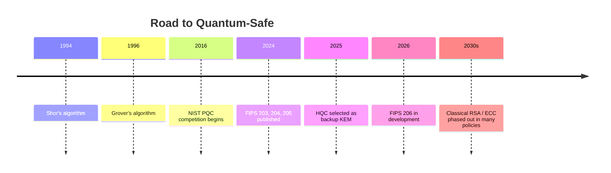
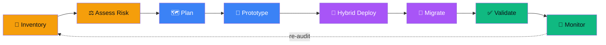
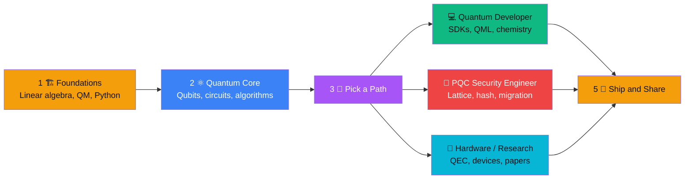
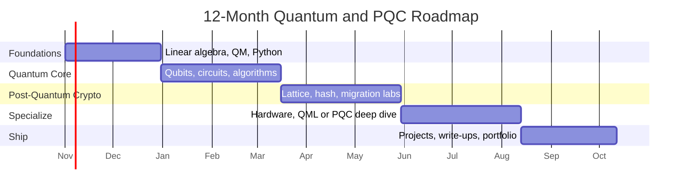

import re
from urllib.parse import quote_plus
from data import *

USER = "Syed-Muhammad-Tayyab"
NAME = "Syed Muhammad Tayyab"

GE = {"found": "🏗️", "blue": "⚛️", "purple": "🧊", "red": "🔐", "eng": "💻", "grc": "🌐"}
DE = {"qmath": "🧮", "qphys": "🌀", "cs": "🖥️", "prog": "🐍", "qubit": "⚛️", "circuit": "🔌", "qalg": "🧠", "qec": "🛡️",
      "qinfo": "📡", "sc": "🧊", "ion": "⚡", "photon": "💡", "atoms": "🔬", "spin": "🧲", "ctrl": "❄️", "lattice": "🕸️",
      "hash": "🌳", "code": "📟", "mvi": "🧬", "threat": "☠️", "agility": "🔄", "sdk": "🧰", "qml": "🤖", "chem": "🧪",
      "opt": "🎯", "cloud": "☁️", "qkd": "🔑", "policy": "📜", "qres": "📚"}
BADGE = {g["id"]: g["color"] for g in GROUPS}
TIPS = {
    "found": "Linear algebra first. Once complex vectors and matrices feel natural, qubits stop being mysterious.",
    "blue": "Run every idea in a simulator before reading the next chapter. Circuits teach faster than theory alone.",
    "purple": "You don't need a physics PhD to understand the platforms. Learn what each one is good and bad at.",
    "red": "Use vetted libraries (liboqs, OpenSSL 3, BoringSSL builds). Never roll your own cryptography.",
    "eng": "Start on simulators, then run small jobs on real hardware through a cloud platform.",
    "grc": "Follow NIST and national agency guidance. Standards and timelines keep moving, so re-check them often.",
}
STARS = lambda n: "⭐" * n + "▫️" * (5 - n)

def anchor(t):
    return "#" + re.sub(r"[^\w\- ]", "", t).lower().replace(" ", "-")

o = []
w = o.append
titles = {g["id"]: f'{GE[g["id"]]} {g["name"]} — {g["type"]}' for g in GROUPS}
typing = ";".join(quote_plus(x) for x in [
    "⚛️ The complete map of Quantum Computing", "🔐 Post-Quantum Cryptography explained",
    "🧩 Qubits → Algorithms → Hardware → PQC", "🛡️ Build quantum-safe systems",
    "📂 Fields, tools, links and folders in one place"])
short = {"found": "Foundations", "blue": "Quantum", "purple": "Hardware", "red": "PQC", "eng": "Software", "grc": "Policy"}
nav = " &nbsp;•&nbsp; ".join([f'<a href="#-the-big-picture"><b>🌴 Tree</b></a>'] +
      [f'<a href="{anchor(titles[g["id"]])}"><b>{GE[g["id"]]} {short[g["id"]]}</b></a>' for g in GROUPS] +
      ['<a href="#-how-everything-is-linked"><b>🔗 Links</b></a>', '<a href="#-folder-structure"><b>📂 Folders</b></a>',
       '<a href="#-learning--certification-roadmap"><b>🎓 Roadmap</b></a>'])

# ---------------- header ----------------
w(f'''<div align="center">


<h3>✨ Developed by {NAME} ✨</h3>

<a href="https://github.com/{USER}">
  
</a>

<br/>


<br/><br/>


<br/><br/>

{nav}

</div>

---
''')

# ---------------- big picture ----------------
w('''## 🌴 The Big Picture

<div align="center">
  
</div>

<div align="center">

| 🖼️ Picture | 📄 PDF Guide | 📊 Slides | 🔗 Link Map | 🔄 Migration Journey |
|:---:|:---:|:---:|:---:|:---:|
| [`qpqc_tree.png`](assets/qpqc_tree.png) | [`QPQC_Tree.pdf`](docs/QPQC_Tree.pdf) | [`QPQC_Tree.pptx`](docs/QPQC_Tree.pptx) | [`qpqc_link_map.png`](assets/qpqc_link_map.png) | [`qpqc_lifecycle.png`](assets/qpqc_lifecycle.png) |

</div>

### ⚖️ Two sides of one story

| | ⚛️ **Quantum Computing** | 🔐 **Post-Quantum Cryptography** |
|:---|:---|:---|
| **Idea** | Use quantum physics to compute in new ways | Use classical math that quantum computers can't break |
| **Runs on** | Qubits (special hardware or simulators) | Ordinary computers, phones and servers |
| **Key algorithms** | Shor, Grover, VQE, QAOA | ML-KEM, ML-DSA, SLH-DSA, FN-DSA, HQC |
| **Main goal** | Solve problems classical machines find too hard | Keep today's secrets safe from tomorrow's machines |
| **Status** | Research and early hardware | Standards published, migration underway |

### 🎯 What quantum computers threaten (and what they don't)

| Today's algorithm | Used for | Quantum impact | What to do |
|:---|:---|:---|:---|
| **RSA, DH** | Key exchange, signatures | ❌ Broken by Shor's algorithm | Move to ML-KEM / ML-DSA |
| **ECC (ECDH, ECDSA)** | Key exchange, signatures, TLS | ❌ Broken by Shor's algorithm | Move to ML-KEM / ML-DSA |
| **AES** | Bulk encryption | ⚠️ Grover roughly halves the effective key strength | Prefer AES-256 |
| **SHA-2 / SHA-3** | Hashing | ⚠️ Grover weakens preimage resistance | Use longer outputs (e.g. SHA-384 / 512) |
| **Hash-based signatures** | Firmware signing | ✅ Quantum-resistant by design | SLH-DSA, LMS / XMSS |

> [!WARNING]
> **Harvest now, decrypt later:** attackers can record encrypted traffic today and decrypt it once a large quantum computer exists. Data that must stay secret for many years needs quantum-safe protection **now**.

### 🌳 Tree view

```text
🌴 QUANTUM COMPUTING & POST-QUANTUM CRYPTOGRAPHY''')
for gi, g in enumerate(GROUPS):
    last_g = gi == len(GROUPS) - 1
    pre = "└──" if last_g else "├──"
    cont = "    " if last_g else "│   "
    w(f"{pre} {GE[g['id']]} {g['name'].upper()}  ({g['type']})")
    ds = domains_of(g["id"])
    for di, d in enumerate(ds):
        last_d = di == len(ds) - 1
        dp = "└──" if last_d else "├──"
        dc = "    " if last_d else "│   "
        w(f"{cont}{dp} {DE[d['id']]} {d['name']}")
        for si, sname in enumerate(d["subs"]):
            sp = "└──" if si == len(d["subs"]) - 1 else "├──"
            w(f"{cont}{dc}{sp} {sname}")
w("```\n")

w("### 🧭 Mind map\n\n```mermaid\nmindmap\n  root((🌴 Quantum<br/>and PQC))")
for g in GROUPS:
    w(f"    {GE[g['id']]} {g['name'].replace('&', 'and')}")
    for d in domains_of(g["id"]):
        w(f"      {DE[d['id']]} {d['name'].replace('&', 'and')}")
w("```\n\n---\n")

# ---------------- PQC standards ----------------
w('''## 📜 PQC Standards at a Glance

> [!NOTE]
> Status below follows NIST's PQC project page (updated August 2026). Standards and timelines keep changing, so always confirm on [csrc.nist.gov](https://csrc.nist.gov/projects/post-quantum-cryptography) before relying on them.

| Standard | Algorithm (original name) | Type | Status |
|:---|:---|:---|:---|
| **FIPS 203** | ML-KEM (CRYSTALS-Kyber) | Key encapsulation | ✅ Published Aug 13, 2024 |
| **FIPS 204** | ML-DSA (CRYSTALS-Dilithium) | Digital signature | ✅ Published Aug 13, 2024 |
| **FIPS 205** | SLH-DSA (SPHINCS+) | Hash-based signature | ✅ Published Aug 13, 2024 |
| **FIPS 206** | FN-DSA (FALCON) | Digital signature | 🛠️ In development |
| **HQC** | HQC (Hamming Quasi-Cyclic) | Backup KEM (code-based) | 🧭 Selected March 11, 2025 for standardization |

### 📏 Why size matters (approximate, bytes)

| Scheme | Public key | Ciphertext / signature | Note |
|:---|:---:|:---:|:---|
| X25519 (classical) | 32 | 32 | tiny, but not quantum-safe |
| ML-KEM-768 | ~1,184 | ~1,088 | the common default KEM |
| ML-DSA-65 | ~1,952 | ~3,309 | lattice signature |
| SLH-DSA-128s | 32 | ~7,856 | very small keys, large signatures |
| FN-DSA-512 (Falcon) | ~897 | ~666 | compact, harder to implement safely |

### ⏱️ Timeline



---
''')

# ---------------- lifecycle ----------------
w('''## 🔄 The Quantum-Safe Migration Journey

<div align="center">
  
</div>

| Step | What happens | Tools & good practice |
|:---|:---|:---|''')
for p, r, b in KILLCHAIN:
    w(f"| **{p}** | {r} | {b} |")
w('''


---
''')

# ---------------- group sections ----------------
for g in GROUPS:
    w(f'## {titles[g["id"]]}\n')
    w(f' '
      f' '
      f'\n')
    w(f'> {g["desc"]}\n')
    w(f"> [!TIP]\n> {TIPS[g['id']]}\n")
    w("| Field | What it covers | Sub-fields | Tools | Learn | Level | Time |")
    w("|:---|:---|:---|:---|:---|:---|:---:|")
    for d in domains_of(g["id"]):
        w(f"| {DE[d['id']]} **{d['name']}** | {d['desc']} | {' • '.join(d['subs'])} | "
          f"{' '.join('`' + t + '`' for t in d['tools'])} | {', '.join(d['certs'])} | {STARS(d['lvl'])} | ~{d['wk']} wks |")
    w("\n<details>\n<summary><b>📁 Folder layout for this branch</b></summary>\n\n```text")
    w(f"{g['folder']}/")
    ds = domains_of(g["id"])
    for j, d in enumerate(ds):
        w(f"{'└──' if j == len(ds) - 1 else '├──'} 📁 {d['folder']}/   (notes/ labs/ papers/ cheatsheets/)")
    w("```\n\n</details>\n\n---\n")

# ---------------- links ----------------
w('''## 🔗 How Everything Is Linked

<div align="center">
  
</div>

### 🕸️ Link graph

```mermaid
flowchart LR''')
cls = {"found": "fnd", "blue": "blu", "purple": "pur", "red": "red", "eng": "eng", "grc": "grc"}
for d in DOMAINS:
    w(f'    {d["id"]}["{DE[d["id"]]} {d["name"].replace("&", "and")}"]:::{cls[d["g"]]}')
for s_, t_, lab in LINKS:
    w(f'    {s_} -->|"{lab.replace("&", "and")}"| {t_}')
w('''    classDef fnd fill:#F59E0B,stroke:#B45309,color:#0D1117
    classDef blu fill:#3B82F6,stroke:#1E40AF,color:#fff
    classDef pur fill:#A855F7,stroke:#6B21A8,color:#fff
    classDef red fill:#EF4444,stroke:#991B1B,color:#fff
    classDef eng fill:#10B981,stroke:#047857,color:#0D1117
    classDef grc fill:#06B6D4,stroke:#0E7490,color:#0D1117
```
''')
w("<details>\n<summary><b>📋 Link table (click to expand)</b></summary>\n\n| From | → | To | Why |\n|:---|:---:|:---|:---|")
for s_, t_, lab in LINKS:
    w(f"| {DE[s_]} {DMAP[s_]['name']} | ➜ | {DE[t_]} {DMAP[t_]['name']} | {lab} |")
w("\n</details>\n\n---\n")

# ---------------- tech stack ----------------
stack = [("Python", "3776AB", "python", "white"), ("Qiskit", "6929C4", "qiskit", "white"), ("NumPy", "013243", "numpy", "white"),
         ("SciPy", "8CAAE6", "scipy", "white"), ("Jupyter", "F37626", "jupyter", "white"), ("OpenSSL", "721412", "openssl", "white"),
         ("Rust", "000000", "rust", "white"), ("C", "A8B9CC", "c", "black"), ("Docker", "2496ED", "docker", "white"),
         ("Linux", "FCC624", "linux", "black"), ("Wireshark", "1679A7", "wireshark", "white"), ("Git", "F05032", "git", "white"),
         ("Cirq", "4285F4", "google", "white"), ("PennyLane", "0A0A0A", "", "white"), ("liboqs", "0D1117", "", "white")]
w('## 🧰 The Core Tech Stack\n\n<div align="center">\n')
for n, c, l, lc in stack:
    logo = f"&logo={l}&logoColor={lc}" if l else ""
    w(f'')
w("\n</div>\n\n---\n")

# ---------------- folders ----------------
w("## 📂 Folder Structure\n\nWhich field lives in which folder. Each leaf folder can hold `notes/`, `labs/`, `papers/` and `cheatsheets/`.\n\n```text")
w("📦 Quantum-PQC-Guide/")
n = len(GROUPS) + len(TOP_FOLDERS_EXTRA)
idx = 0
for g in GROUPS:
    idx += 1
    pre = "└──" if idx == n else "├──"
    cont = "    " if idx == n else "│   "
    w(f"{pre} 📁 {g['folder']}/   # {GE[g['id']]} {g['type']}")
    ds = domains_of(g["id"])
    for j, d in enumerate(ds):
        w(f"{cont}{'└──' if j == len(ds) - 1 else '├──'} 📁 {d['folder']}/")
for f_, desc in TOP_FOLDERS_EXTRA:
    idx += 1
    w(f"{'└──' if idx == n else '├──'} 📁 {f_}/   # {desc}")
w("```\n\n---\n")

# ---------------- roadmap ----------------
w('## 🎓 Learning & Certification Roadmap\n\n| Track | Courses & Certifications |\n|:---|:---|')
for a, b, c in CERTS:
    w(f"| **{a}** | {b} |")
w('''


### 🗓️ A 12-month plan



### 🧪 Portfolio project ideas

| Level | Project | Skills you practice |
|:---|:---|:---|
| 🟢 Beginner | Bell-state circuit and CHSH test on a simulator | Qubits, entanglement, Qiskit |
| 🟢 Beginner | Quantum teleportation circuit | Gates, measurement, circuits |
| 🟡 Intermediate | Grover search on a small puzzle | Algorithms, amplitude amplification |
| 🟡 Intermediate | Benchmark ML-KEM vs X25519 with liboqs | PQC, performance, C / Python |
| 🔴 Advanced | Hybrid TLS handshake lab with OQS-OpenSSL | PQC migration, TLS, PKI |
| 🔴 Advanced | Crypto inventory (CBOM) scanner for a repository | Crypto-agility, static analysis |

**Practice platforms:** `IBM Quantum` • `Amazon Braket` • `Azure Quantum` • `PennyLane Codebook` • `Qiskit Textbook` • `Open Quantum Safe` • `arXiv quant-ph` • `NIST CSRC`

---

## ⚠️ Disclaimer

<div align="center">

**This repository is for education.** Use vetted, standards-based libraries for any real cryptography and follow official NIST and national agency guidance.
Never design your own cryptographic algorithms for production use.

</div>

---

## 🤝 Connect

<div align="center">

<a href="https://github.com/Syed-Muhammad-Tayyab"></a>

⭐ **If this guide helped you, give the repo a star!** ⭐

<h3>✨ Developed by Syed Muhammad Tayyab ✨</h3>


</div>
''')

open("/mnt/user-data/outputs/README_QPQC.md", "w", encoding="utf-8").write("\n".join(o))
print("readme ok", len("\n".join(o)))
